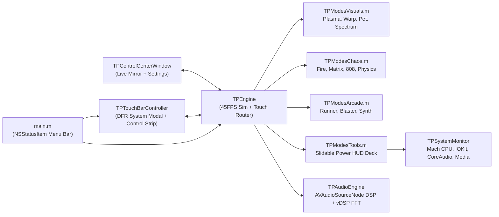

# ⚡ TouchPulse

**Turn your MacBook Pro's OLED Touch Bar into an always-on interactive visuals lab, playable synthesizer & 808 beatbox, multi-touch arcade strip, and horizontally slidable Power HUD control deck.**

Built in pure native **Objective-C + CoreGraphics + CoreAudio + AVFoundation + Accelerate (`vDSP`) + IOKit** with zero external dependencies and zero Xcode IDE required — just macOS Command Line Tools (`clang`).

---

## ✨ What Is TouchPulse?

Most MacBook Pro Touch Bars sit mostly idle showing static buttons. **TouchPulse** reclaims that crisp 2170×60 Retina OLED multi-touch display and keeps it alive **across every app** using macOS's system-modal Touch Bar & Control Strip APIs, paired with:

- **Always-On System Mode** — stays live on your Touch Bar even while browsing, coding, or watching videos, with a quick-toggle icon in both the macOS **Control Strip** and the top **Menu Bar**.
- **Full-Width Cinema Mode (`⌘F`)** — expands edge-to-edge across the entire Touch Bar over the Control Strip for maximum OLED immersion.
- **Companion Control Center & Live Mirror** — dark obsidian window featuring a live interactive 1:1 Touch Bar mirror (click, drag, flick, or slide directly on screen or on the Touch Bar itself).
- **Zero-Latency Real-Time Audio Engine** — custom polyphonic stereo-panned DSP synthesizer, ping-pong delay, synthesized TR-808/303 drum & bass voices, sci-fi SFX, and an optional live `Accelerate`/`vDSP` Microphone FFT analyzer.
- **5 Dynamic OLED Color Palettes** — *Cyberpunk Neon*, *Solar Inferno*, *Aurora Borealis*, *Vaporwave Sunset*, and *Matrix Emerald*.

---

## 🎮 All 12 Interactive Modes

### Chaos Visuals, Physics & Live Music
| Key | Mode | What It Does & How to Interact |
| :-: | :--- | :--- |
| `1` | **⚡ Chaos Plasma** | Real-time coupled wave simulation + neon aurora ribbons. Touch to emit forked Tesla coil tendrils; touch with **2+ fingers** for double-stranded high-voltage plasma arcs; **flick fast** to launch bouncing **Ball Lightning Orbs**. |
| `2` | **✦ Black Hole Collider** | 220-star 3D hyperspace warp field. Hold **1 finger** for a gravitational accretion-disk Black Hole; hold **2 fingers** to create **Binary Black Holes** linked by a tidal plasma jet — bring them together or release for an **RGB Big Bang Supernova**. |
| `3` | **▲ Inferno & Fireworks** | Real Doom-style 2D cellular fire (`160×14` heat simulation) roaring across the OLED bar. **Drag** to whip flames like a flamethrower/windstorm; **tap** anywhere to launch neon starburst firework rockets. |
| `4` | **⌘ Matrix Breach** | 72 columns of cascading Japanese Katakana & hex digital rain. Touch or swipe to tear open **RGB chromatic glitch breaches** with telemetry chirps and sci-fi security alerts (`MAINFRAME BREACHED`, `ACCESS GRANTED`). |
| `5` | **◈ 808 Beatbox** | Live playable **16-step TR-808 drum & 303 acid bass sequencer** on your Touch Bar. Tap vertical zones per step (**Bottom = 808 Kick**, **Middle = Snare/Hi-Hat**, **Top = 303 Acid Synth**), or tap `▶/❚❚` and `↻` (Randomize Groove) on the left. |
| `6` | **◉ Mercury Vortex** | 78 colliding liquid-mercury neon orbs with elastic physics & tether webs. **Swipe fast** to bowl through them; **touch & hold** to summon a magnetic tornado vortex — release for a slingshot explosion. |

### Arcade Games, Instrument, Companion & Audio
| Key | Mode | What It Does & How to Interact |
| :-: | :--- | :--- |
| `7` | **▸ Cyber Runner** | Endless synthwave Touch Bar runner with parallax skyline. Tap to jump & tap mid-air for a **Jetpack Double-Jump** over spikes, laser pylons, and drones while grabbing gold energy diamonds. Saves high score automatically. |
| `8` | **◎ Laser Blaster** | Multi-touch arcade meteor zapper. Tap glowing orbs with 1–5 fingers to fire crackling lightning bolts, chain combos with ascending pentatonic chimes, and trigger **OVERDRIVE 2x**. |
| `9` | **♫ Neon Laser Synth** | Playable 18-string polyphonic Laser Harp with stereo panning matching finger X-position, ping-pong delay, physically vibrating standing-wave strings, live output oscilloscope, and 5 musical scales (*Cyber Pentatonic*, *Dreamy Major 9*, *Dark Synthwave*, *Lofi Blues*, *Chromatic*). |
| `0` | **★ Cyber Nyan Squad** | Pixel-art cyber cat that tracks your Mac's mouse cursor, naps with `zZ` when idle, chases glowing treats you drop by tapping, purrs & backflips with hearts when petted, and rockets in **★ TURBO** rainbow squad formation. |
| `-` | **ılı Spectrum Pulse** | 36-band segmented OLED LED equalizer with gravity peak-hold caps and waveform overlay. Works immediately in Touch Beat mode, or enable **Live Mic FFT** (`vDSP`) to react to music playing out of your speakers. |

### Everyday Mac Superpowers
| Key | Mode | What It Does & How to Interact |
| :-: | :--- | :--- |
| `=` | **⊞ Power HUD Deck** | **Horizontally slidable kinetic control deck** (swipe/flick left & right with momentum inertia, rubber-band bounce, bottom scrollbar & `<` / `>` edge hints — zero cramped or clipped text!). |

**Widgets inside the Slidable Power HUD Deck:**
- **🎵 Now Playing & Media Deck** — Live Spotify & Apple Music track marquee + `⏮` `⏯` `⏭` buttons
- **🔊 Native CoreAudio System Volume + `🔇` One-Tap Mute** — Tap anywhere on the bar to set exact hardware volume immediately
- **📸 SNAP** — Interactive area screenshot straight to clipboard (`screencapture -i -c`)
- **☕ AWAKE** — One-tap Keep Awake (prevents display sleep via `IOPMAssertion`)
- **🔒 LOCK** — Instant Mac lock screen (`SACLockScreenImmediate`)
- **◉ Pomodoro Focus Timer** — Tap to start/pause, double-tap to reset (runs in background across all modes with a chime on completion)
- **🔥 CPU Monitor** — Live overall `%`, per-core dancing equalizer across every logical CPU thread, and rolling sparkline
- **🧠 RAM Breakdown** (`Used / Total GB`) & **💾 SSD Free Space**
- **🌐 Live Network Throughput** (`↓ / ↑` bytes/sec across active interfaces)
- **🔋 Detailed Battery** (`%`, charging bolt, and estimated time remaining)
- **🚀 Quick App Launcher** — One-tap switch/launch for `>_ Terminal`, `⊞ Finder`, `◎ Browser`, and `✎ Notes`
- **🕒 Live Clock & Date**

---

## 🕹 Controls & Shortcuts

| Action | How |
| :--- | :--- |
| **Cycle modes from Touch Bar** | Tap the glowing pill on the far-left edge of the Touch Bar |
| **Cycle color palettes from Touch Bar** | Tap anywhere on the Touch Bar with **3 fingers simultaneously** |
| **Slide hidden Power HUD widgets** | Swipe / flick left or right on the Touch Bar in Power HUD mode |
| **Switch modes from keyboard** | Focus Control Center and press `1`–`9`, `0`, `-`, `=` |
| **Switch color theme from keyboard** | Press `T` in Control Center |
| **Toggle Always-On / Full-Width** | `⌘T` (Always-On) / `⌘F` (Full-Width Cinema) or via Menu Bar |
| **Run silently in background** | Close the Control Center window (`⌘W`) — TouchPulse stays active on your Touch Bar & Menu Bar |

---

## 🛠 Requirements & Building from Source

### Requirements
- **macOS 12.0+** (tested on **macOS 15.8 Sequoia**) on a **MacBook Pro with Touch Bar** *(also runs on non-Touch-Bar Macs via the interactive on-screen Touch Bar Mirror!)*
- **Xcode Command Line Tools** (`xcode-select --install`) — full Xcode IDE is **not** required.

### Build & Run
```bash
git clone https://github.com/VishnuSuryaTejaa/TouchPulse.git
cd TouchPulse
./build.sh
open TouchPulse.app
```

### Install Permanently to `/Applications`
```bash
cp -R TouchPulse.app /Applications/
```

> **Note on Permissions:** TouchPulse requires **zero Accessibility permissions**. Optional macOS Microphone permission is only requested if you explicitly click **Enable Live Mic FFT** in Spectrum Pulse mode.

---

## 🏗 Architecture Overview



### Project Layout
```text
TouchPulse/
├── build.sh                     # Compiles native binary, generates .icns, signs TouchPulse.app
├── README.md                    # Project overview, features, architecture, and roadmap
├── LICENSE                      # MIT License
├── docs/
│   └── UPGRADE_GUIDE.md         # Step-by-step developer guide & blueprints for future upgrades
├── tools/
│   └── make_icon.m              # Procedural CoreGraphics 1024px squircle AppIcon.icns generator
└── src/
    ├── TPCommon.h               # Shared enums (TPMode, TPTheme, TPSynthScale), touch & math helpers
    ├── TPTheme.m                # 5 OLED color palettes, cached fonts, glow & CoreGraphics helpers
    ├── TPAudioEngine.h/.m       # Lock-protected real-time DSP synth, 808/303 SFX, delay & vDSP FFT
    ├── TPSystemMonitor.h/.m     # Per-core CPU, RAM, SSD, Battery, Net, CoreAudio Vol/Mute, Media
    ├── TPEngine.h/.m            # Master 45FPS loop, unified multi-touch pipeline, particle pool, HUD
    ├── TPModesVisuals.m         # Chaos Plasma, Black Hole Collider, Cyber Nyan Squad, Spectrum Pulse
    ├── TPModesChaos.m           # Inferno & Fireworks, Matrix Breach, 808 Beatbox, Mercury Vortex
    ├── TPModesArcade.m          # Cyber Runner, Laser Blaster, Neon Laser Harp Synth
    ├── TPModesTools.m           # Kinetic horizontally-scrollable Power HUD & Handy Control Deck
    ├── TPTouchBarController.h/.m# Private DFR system-modal presentation, Control Strip & CanvasView
    ├── TPControlCenterWindow.h/.m# Companion dark-glass Control Center UI with live interactive mirror
    └── main.m                   # NSApplicationDelegate, Menu Bar item, global menus & lifecycle
```

---

## 🚀 Future Upgrades & Roadmap

TouchPulse was deliberately structured around a clean single-engine + category-module architecture so new visuals, games, audio features, and productivity widgets can be bolted on cleanly. See **[docs/UPGRADE_GUIDE.md](docs/UPGRADE_GUIDE.md)** for full code blueprints and step-by-step extension instructions!

### Planned & Recommended Future Upgrades

#### 1. High-Performance Graphics & Visuals
- **Metal GPU Shader Pipeline (`CAMetalLayer` / `MTKView`)** — Replace CPU CoreGraphics rendering for ultra-heavy modes (true 2D Navier-Stokes fluid smoke, raymarched 3D tunnels, Mandelbrot/Julia fractals, and glowing reaction-diffusion) at locked 60 FPS with <3% CPU.
- **Typing / Keystroke Shockwave Mode** — Optional Accessibility/Input Monitoring toggle so every keystroke on the MacBook keyboard sends shockwaves, sparks, or Matrix glyphs erupting straight up onto the Touch Bar right above the key you pressed.

#### 2. Next-Level Audio Reactivity
- **Direct System Audio Loopback (Zero-Mic Spectrum)** — Use macOS 14.2+ **CoreAudio Process Tap (`AudioHardwareCreateProcessTap` / `CATapDescription`)** so **Spectrum Pulse** reacts directly to Spotify, YouTube, or Apple Music audio output with zero microphone noise or ambient room pickup.
- **Expanded 808 Beatbox & MIDI Out** — Add tempo BPM tap/slider, multiple savable beat patterns, swing control, and CoreMIDI output so the Touch Bar acts as a real hardware MIDI controller for Logic Pro / Ableton Live.

#### 3. Productivity & Power HUD Customization
- **Configurable Power HUD & Custom Widget Plugins** — Persist widget order, visibility, and custom shell-script buttons in `~/Library/Application Support/TouchPulse/config.json` (e.g., show Git branch, Docker status, unread emails, weather, crypto/stock ticker, or trigger custom AppleScripts/shortcuts).
- **Brightness & Keyboard Backlight Scrubbers** — Add smooth touch scrub bars for display brightness and keyboard illumination alongside the native CoreAudio volume scrubber.
- **Live Clipboard History Strip** — Tap-to-paste recent clipboard snippets directly from a scrollable Touch Bar drawer.
- **Universal Media Support (`MediaRemote` / Now Playing)** — Expand Now Playing beyond Spotify & Apple Music to include YouTube/Chrome/Safari/VLC via media session hooks.

#### 4. macOS Integration & Distribution
- **Launch at Login (`SMAppService`)** — One-click toggle in Control Center to start TouchPulse automatically when you log in.
- **Global System-Wide Hotkeys** — Register global shortcuts (`Carbon` `RegisterEventHotKey` or `NSEvent` global monitor) to cycle modes or summon Full-Width mode from any app.
- **Persistent User Preferences** — Save active mode, theme, speed, volume, Always-On state, and Full-Width mode to `NSUserDefaults` across restarts.
- **Universal Binary (`x86_64` + `arm64`) & Homebrew Cask / GitHub Releases** — Build fat binaries with `clang -arch x86_64 -arch arm64` so both Intel Touch Bar MacBook Pros and M1/M2 13-inch Touch Bar MacBook Pros are supported out of the box.

---

## 📄 License

MIT License — see [LICENSE](LICENSE). Feel free to fork, hack on crazy new modes, and open PRs!
